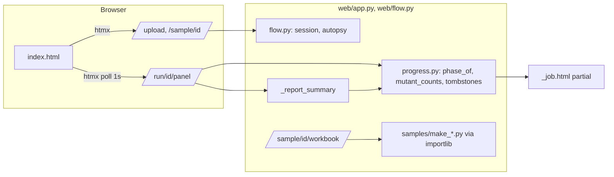

# Design Document: front-door

## Overview

This feature replaces the bare landing page and raw-log progress view with a
designed front door: a Landing_Page that explains Ghost, a shared Stepper, Sample_Cards
with a workbook download, a Progress_Rail driven by a pure Progress_Module, designed
Failure_Cards, and a haunted-lab Theme_Pass. No business logic moves into `web/`; the
Progress_Module only maps strings and a status to presentation data, and the new route
reuses the existing sample-generation and scrubbing code paths.

Everything the interface states as a number or a phase traces to an Event_Line, a Job
status, or the Proof_Report — never an estimate (Requirement 13).

## Architecture



### Templates and partials

- `web/templates/_stepper.html` (new): the five-step Stepper, included by
  `index.html`, `_autopsy.html`, `_upload_result.html`, `_job.html`. Takes a
  `current_step` context key with one of `"exhume" | "autopsy" | "verdict" | "trial" |
  "resurrection"`.
- `web/templates/_sample_card.html` (new): one Sample_Card, included three times by
  `index.html`. Takes `id`, `label`, `blurb`, `measured` (or `None`).
- `web/templates/_progress_rail.html` (new): extracted from `_job.html`; renders
  Status_Line, Mutation_Bar, Graveyard_Grid or "not checked" text, and the raw-log
  `<details>`. Takes the dict returned by `progress.rail_context(...)`.
- `web/templates/_failure_card.html` (new): one Failure_Card. Takes `kind` (one of the
  six cases), `title`, `message` (a Pinned_Error_Text, unchanged), `next_step`.
- `web/templates/404.html` (new): page-not-found Failure_Card wired through FastAPI's
  `exception_handlers` for `404`.
- `index.html`, `_job.html`, `_message.html`, `_upload_result.html`, `_autopsy.html`:
  edited to include the new partials and reorder content per Requirement 1.1.

### `web/progress.py` (new, pure module)

No imports from `ghost.*`, no file/network/process I/O, per Requirement 6.2.

```python
from dataclasses import dataclass
from enum import IntEnum

class Phase(IntEnum):
    QUEUED = 0
    VERIFICATION_STARTED = 1
    MUTATION_SELF_CHECK = 2
    CASES_COMPARED = 3
    PROOF_WRITTEN = 4

PHASE_LABELS: dict[Phase, str] = {
    Phase.QUEUED: "Queued",
    Phase.VERIFICATION_STARTED: "Verification started",
    Phase.MUTATION_SELF_CHECK: "Mutation self-check",
    Phase.CASES_COMPARED: "Cases compared",
    Phase.PROOF_WRITTEN: "Proof written",
}

def phase_of(events: list[str], status: str) -> Phase:
    """Highest Phase whose Phase_Marker is present in `events`, given `status`."""

@dataclass(frozen=True)
class MutantCounts:
    done: int | None  # largest i seen
    total: int | None  # n of the latest matching line

def mutant_counts(events: list[str]) -> MutantCounts:
    """Parses `mutation check: mutant i/n` lines; ignores lines where i > n."""

def status_line_text(phase: Phase) -> str:
    """Pure function Phase -> text; PHASE_LABELS[phase]. Same phase, same text."""

@dataclass(frozen=True)
class Tombstone:
    mutant_id: str
    operator: str
    location: str
    state: str  # "neutral" | "killed" | "survived"

def tombstones(status: str, counts: MutantCounts, mutation_block: dict | None) -> list[Tombstone]:
    """Neutral tombstones while queued/running or on failed/timeout; killed/survived
    from `mutation_block['mutants']` only when status == 'done' and the block has
    'total'. Returns [] when there is nothing to show (callers check `has_total`)."""

def has_mutation_total(mutation_block: dict | None) -> bool:
    """True only if mutation_block is not None and 'total' in mutation_block."""

def rail_context(events: list[str], status: str, mutation_block: dict | None) -> dict:
    """Assembles phase, status_line text, mutant_counts, tombstones and the
    'not checked' flag for `_progress_rail.html`."""
```

`phase_of` scans `events` once, classifying each line against the five
Phase_Markers (Requirement 6 Glossary) with compiled regexes; a
`mutation check: not checked (...)` line matches no marker (Requirement 6.13) because
it does not match the `mutation check: mutant <i>/<n>` pattern. The function is a pure
fold: it never decreases the running maximum Phase (Property 1), and a line matching no
marker leaves the fold's accumulator unchanged (Property 2). `status` contributes only
the floor `Phase.QUEUED` when no marker has been seen. `status_line_text(phase, status)` reads "Starting" for that floor when the job is `running`, and "Queued" otherwise.

### New route: `GET /sample/{id}/workbook`

Added in `web/app.py`, beside the existing `/sample/{id}` route. Builds the workbook
with `_build_sample` (the same helper the existing route uses, backed by
`samples/make_*.py`) into a `tempfile.TemporaryDirectory`, never into `session.folder`,
`samples/`, or `graveyard/` (Requirement 4.5). Returns
`FileResponse`/`Response` with
`media_type="application/vnd.openxmlformats-officedocument.spreadsheetml.sheet"` and
`Content-Disposition: attachment; filename="<fname>"` from `SAMPLES`. Unknown id →
`page(request, "_failure_card.html", {"kind": "not_found", ...}, 404)`. Because
`_build_sample` always regenerates from the committed generator script with the same
inputs, two downloads of the same id produce byte-for-byte identical cell content
(Requirement 4.7); the test compares parsed cell/formula values rather than raw bytes,
since `openpyxl` can write non-deterministic zip metadata.

### Failure cards and detection rules

`web/flow.py` gains `failure_kind(exc_or_status, message) -> str | None` mapping to one
of `session_expired | job_failed | job_timed_out | referee_unavailable | file_rejected |
not_found`:

| Kind | Detection |
|---|---|
| `session_expired` | `session_of(request) is None` where a route requires a session |
| `job_failed` | `job.status == FAILED` |
| `job_timed_out` | `job.status == TIMEOUT` |
| `referee_unavailable` | `GET /healthz` body `available: false` (503), or `job.error`/upload error text contains `"Referee"` or `"soffice"` |
| `file_rejected` | response status `413` or `422` |
| `not_found` | unmatched route, or unknown `sample_id` |

Each existing call site that currently returns a Pinned_Error_Text now also passes a
`kind` to `_failure_card.html`, which renders `title` and `next_step` around the
unchanged `message` inside the existing `role="alert"` element (Requirement 10.7–10.8).

### Focus, busy state and the result container (no new dependency)

`web/static/htmx-errors.js` gains two listeners (no new `<script>` tag, no package):

- `htmx:beforeRequest` / `htmx:afterRequest` on `[hx-post],[hx-get]` toggle
  `aria-busy="true"` + `disabled` and a `data-busy-label` driven text swap.
- `htmx:afterSwap` on `#result`: `const h = result.querySelector("h1,h2,h3"); (h ||
  result).focus()`. `#result` is given `tabindex="-1"` in `index.html` so it is a valid
  focus target when there is no heading (Requirement 5.4).

### Status line placement

`_progress_rail.html` renders one `<p id="status-line" aria-live="polite">{{
status_line_text }}</p>` whose `id` is stable across polls (same DOM node swapped
in-place by htmx `outerHTML` on `.job`, but the id persists so assistive tech tracks it
across the `aria-live` region). The polled root (`<section class="job">`) itself drops
the `aria-live="polite"` it has today (Requirement 9.3); the `<details>` raw log also
carries no `aria-live`.

### CSS approach for the report iframe white slab

`web/static/style.css`: in the dark theme selector, set the iframe wrapper's
`background: var(--bg)` and the `<iframe class="report">` element
`color-scheme: dark` plus a wrapping `div.report-frame { background: var(--bg); padding:
0; }`. No change to the Proof_Report HTML the engine writes; the fix is confined to the
iframe element's own attributes and surrounding chrome (Requirement 11.4–11.5).

## Components and Interfaces

| Component | File | Responsibility |
|---|---|---|
| `Stepper` partial | `web/templates/_stepper.html` | Renders the five steps and `aria-current`; included by every screen |
| `Sample_Card` partial | `web/templates/_sample_card.html` | One sample's blurb, Run button, download link, measured duration |
| `Progress_Rail` partial | `web/templates/_progress_rail.html` | Status_Line, Mutation_Bar, Graveyard_Grid or "not checked", raw log |
| `Failure_Card` partial | `web/templates/_failure_card.html` | Title, Pinned_Error_Text, next step, `role="alert"` |
| `progress.py` | `web/progress.py` | Pure functions `phase_of`, `mutant_counts`, `status_line_text`, `tombstones`, `has_mutation_total`, `rail_context` |
| Sample workbook route | `web/app.py` (`GET /sample/{id}/workbook`) | Builds and streams a fresh sample workbook from `samples/make_*.py` |
| Failure classification | `web/flow.py` (`failure_kind`) | Maps a request/response outcome to one of six Failure_Card kinds |
| Busy/focus script | `web/static/htmx-errors.js` | `aria-busy`/`disabled` toggling and post-swap focus movement |
| Theme CSS | `web/static/style.css` | Stepper/card/tombstone/verdict styling and the dark-theme iframe fix |

`progress.py` is the only new component with logic; every other new piece is template
or static-asset wiring. `web/app.py` and `web/flow.py` call into `progress.py` and
`ghost.*`/existing helpers only — no new business logic is introduced (Requirement
14.6).

## Data Models

```python
# web/progress.py
class Phase(IntEnum): ...          # ordinal, comparable, see above
@dataclass(frozen=True)
class MutantCounts:
    done: int | None
    total: int | None
@dataclass(frozen=True)
class Tombstone:
    mutant_id: str
    operator: str
    location: str
    state: str  # "neutral" | "killed" | "survived"
```

```python
# web/app.py or web/flow.py — Measured_Duration file (Requirement 3.6, 3.8)
# web/measured_runs.json, committed, read at request time (no computation there):
# {"discount": {"seconds": 5.3, "date": "2026-11-24", "cases": 500, "measured_on": "local development machine (macOS), not the deployed host"}, ...}
```

No change to the `proof-report-1` schema and no new field added to it (Requirement
13.6, 14.5).

## Correctness Properties

*A property is a characteristic or behavior that should hold true across all valid
executions of a system — essentially, a formal statement about what the system should
do. Properties serve as the bridge between human-readable specifications and
machine-verifiable correctness guarantees.*

All properties below are implemented with Hypothesis, explicit seed `20261204`, minimum
100 iterations, and need no LibreOffice — `web/progress.py` is pure. Each test file is
tagged `# Feature: front-door, Property N: <title>`.

### Property 1: Phase index is monotone under append

For any list of Event_Lines and any line appended to it, `phase_of(events + [line],
status)` is greater than or equal to `phase_of(events, status)` for the same `status`.

**Validates: Requirements 6.9, 16.1**

### Property 2: Unrecognised lines never change the phase

For any list of Event_Lines and any line that matches none of the five Phase_Markers,
`phase_of(events + [line], status)` equals `phase_of(events, status)`.

**Validates: Requirements 6.10, 16.2**

### Property 3: Mutant counts stay within bounds and tombstone count matches the total

For any list of Event_Lines, `mutant_counts(events).done` is less than or equal to
`mutant_counts(events).total` whenever `total` is not `None`; and for any finished Job
whose Mutation_Block has a `total`, `len(tombstones(...))` equals that `total`.

**Validates: Requirements 7.6, 7.7, 8.1, 8.9, 16.3**

### Property 4: Status_Line text is a pure function of Phase and Job status
For any two calls to `status_line_text(phase, status)` with the same `phase` and `status`,
the returned text is identical, and it equals the Phase name, except for Phase Queued with
status `running`, which reads "Starting" (a running job whose first marker has not arrived
yet). Appending a line that does not change the Phase does not change the text.

**Validates: Requirements 9.4, 9.5, 16.5, 16.6**

### Property 5: Killed and survived tombstone counts match the finished report

For any finished Job with a Mutation_Block holding `total`, `killed`, and a `mutants`
list whose `killed` flags are consistent with `killed`/`total`, the number of
`Tombstone`s with state `"killed"` equals `mutation_block["killed"]` and the number with
state `"survived"` equals `mutation_block["total"] - mutation_block["killed"]`.

**Validates: Requirements 8.3, 8.4, 16.4**

### Property 6: Determinism of `phase_of`

For any list of Event_Lines and status, calling `phase_of` twice on the same arguments
returns the same Phase.

**Validates: Requirements 6.15**

**Property reflection.** The narrower statements "mutant_done <= mutant_total" and
"tombstone count == total" from the feature prompt are subsumed by the property titled
"Mutant counts stay within bounds and tombstone count matches the total" above, so they
are expressed as one property with two clauses rather than two separate properties. The
property titled "Determinism of phase_of" is kept distinct from the monotonicity and
unrecognised-line properties because determinism (same input twice) is a different
quantifier shape than monotonicity-under-append and could pass independently if
`phase_of` used hidden mutable state. The property titled "Status_Line text is a pure
function of Phase" is the Status_Line analogue of that determinism property and is kept
separate because it exercises a different function (`status_line_text`, not
`phase_of`).

## Error Handling

- `GET /sample/{id}/workbook` with an unknown id: `404` via `_failure_card.html`
  (`kind="not_found"`), no server path, per Requirement 4.3, 4.6, 10.6.
- Sample generation failure (`IngestError`) during the download build: `422` with the
  existing scrubbed message, no partial file left outside the temporary directory.
- `GET` for any unmatched route or unknown sample id elsewhere in the app: FastAPI
  `404` exception handler renders `404.html` with a link to `/` (Requirement 10.6).
- Referee-unavailable detection reuses the existing `/healthz` check and the existing
  error text; the Failure_Card adds a title and next step without altering the Pinned
  message (Requirement 10.4, 10.8).
- `phase_of` and `mutant_counts` never raise on malformed lines — a line that does not
  match a marker regex is simply not a marker (Requirement 6.10); a `mutant i/n` line
  with non-integer `i`/`n` is likewise treated as unrecognised.

## Testing Strategy

**Test-first**: every new behaviour in this feature gets a failing test before the
implementing code, built from workbooks and event lists constructed inside the test
(Requirement 14.3) — no change to any fixture under `tests/fixtures/` other than the new
recorded-event-lines fixture below.

**Unit / example tests** (`tests/test_web_*.py`, extending the existing suite):
- Landing_Page element order, Stepper `aria-current` for each of the five states,
  Sample_Card content and the "(generated)" label, `GET /sample/{id}/workbook` status
  codes and content type, idempotent cell content across two downloads, Failure_Card
  rendering for each of the six kinds with its Pinned_Error_Text intact, 360 px and
  dark-theme assertions alongside the existing accessibility tests.
- A recorded-event-lines fixture, `tests/fixtures/front_door/haunted_run_events.json`,
  captured at implementation time by running `scripts/demo.sh` or the CLI locally
  against the haunted sample and copying the real, scrubbed `Starting verification`,
  `mutation check: mutant i/n`, `[faithful]`/`[intended]`, and `Proof report:` lines in
  the order the CLI printed them — never invented (Requirement 15, Guardrail 5). The
  regression test in Requirement 15.2 feeds these lines to `phase_of` one at a time and
  asserts the Phase sequence.

**Property tests** (`tests/test_property_progress_module.py`, Hypothesis, seed
`20261204`, ≥100 iterations each, no LibreOffice): Properties 1–6 above, each its own
test function tagged `# Feature: front-door, Property N: <title>`.

**Unchanged**: every existing web test keeps its current assertions, including
`tests/test_web_accessibility.py`'s border-contrast and theme-toggle assertions and the
no-server-paths tests; the full suite must show the Baseline (1061 passed, 3 skipped, 1
xfailed) plus only this feature's new tests, 0 failed (Requirement 14.1–14.2).

## Known limits (owner decisions, 2026-11-25; recorded, not fixed)
- **N in the verdict sentence is `cases_tested`**, generated plus targeted (311 on the haunted sample). The distinct count (200) is not the N of the sentence; both appear on the page, the distinct count in the parenthetical.
- **Mutant lines are parsed up to 9999.** `mutation check: mutant <i>/<n>` with a number of five or more digits is not a Phase_Marker and is ignored. The engine has no cap on the number of mutants; 10,000 would be unlikely to finish inside the job timeout, and the largest recorded run is 132. Pinned by `test_four_digit_limit_is_exact`.
- **A finished report whose `mutants` list is shorter than its `total`** shows as many tombstones as the list holds, not `total`. The engine writes `total = len(records)`, so it cannot produce that report.
- **The event buffer keeps 500 lines** (`web/jobs.py` `MAX_EVENTS`). Measured on 2026-11-25 through the web job runner with mutation on (100 cases per mutant): discount 48 lines, haunted 50, scenarios 201 (132 of them mutant lines). All are under 250, so the Phase cannot move backwards for the bundled samples. A workbook that prints more than 500 lines could push `Starting verification` out of the buffer; the Phase is recomputed from the buffer on each poll.
- **Verdict sentences** are built from `passed`, `mode`, `cases_tested` and `mismatches` only; a report that contradicts itself gets the bare label, and a report with no `passed` field reads "Verdict not available".
