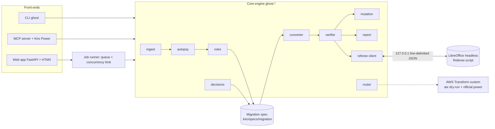
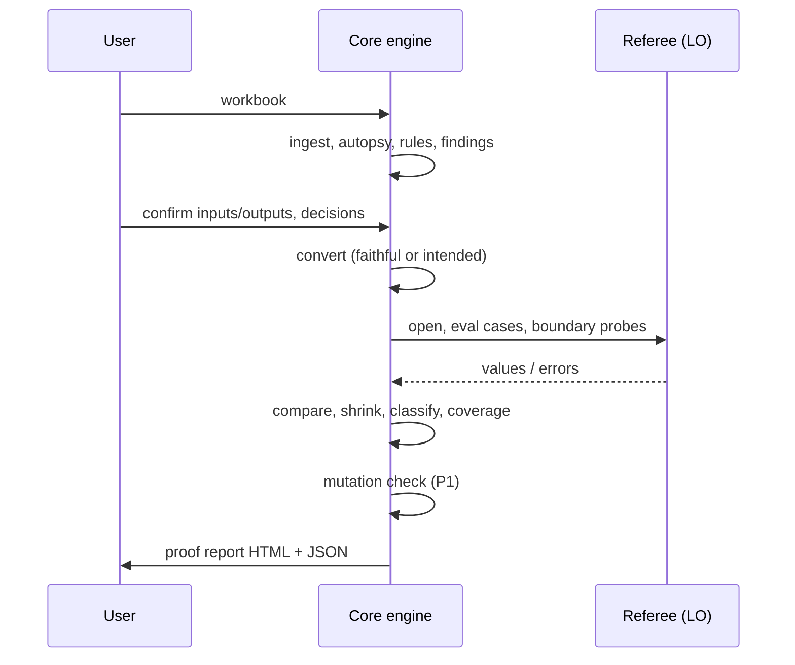

# Design Document

## Overview

Ghost in the Macro is a Python 3.11+ library (`ghost`) with four front ends: a CLI, an MCP server (packaged as a Kiro Power), and a FastAPI web app. All front ends call the same Core_Engine. The engine ingests a workbook, classifies cells, derives deterministic EARS rules, transpiles formulas to a pure Python module, and verifies that module against the original workbook recalculated in headless LibreOffice (the Referee).

Key design decisions:

| Decision | Rationale |
|---|---|
| Referee runs inside LibreOffice and connects back over a localhost socket (prototype finding 1) | Avoids UNO bridge setup differences between macOS and Linux; verified on both. |
| One long-lived LibreOffice per job | LO start is about 4 s; 300 cases take about 5 s once running (finding 10). |
| Deterministic transpiler, no LLM in the web app | No API keys, reproducible output, same verifier as the Power path. |
| Decimal arithmetic with `Decimal(repr(x))` | Money correctness and Excel-like decimal behaviour. |
| Unsupported constructs are listed "not converted", never guessed | Proof integrity. |
| Boundary probing in addition to random tests | Random testing missed `>500` vs `>=500` in 2,000 cases (finding 7). |
| Macros off by default; on only for trusted sources | Security (finding 3). |
| Sanity check reports "not cross-checked" for script-written files | Script-written files carry no Excel results (finding 9). |
| Everything the report states comes from engine output | No invented data. |

Research notes (from the prototype findings, given as facts): LibreOffice VBA Round follows half-even while worksheet ROUND follows half away from zero (finding 8). Writing `.xlsm` samples without Excel needs the VBA-compatibility settings in requirement 5.15 (finding 5). Debian/Ubuntu need `libreoffice-calc-nogui` and `libreoffice-script-provider-python` (finding 1).

## Architecture



Pipeline for one migration:



### Package layout

```
ghost/
  ingest/        workbook.py, vba.py, limits.py
  autopsy/       classify.py, thresholds.py, findings.py, metrics.py
  rules/         ears.py, ids.py, spec_writer.py
  referee/       client.py, script/ghost_referee.py, locate.py, profile.py
  converter/     parser.py, ast.py, emit_python.py, semantics.py, subset.py
  verifier/      strategies.py, compare.py, boundary.py, coverage.py, classify.py, run.py
  mutation/      mutants.py, run.py
  report/        model.py, html.py, schema/proof-report-1.json
  decisions/     store.py
  router/        route.py, thresholds.py
  cli.py
mcp_server/      server.py
web/             app.py, jobs.py, templates/, static/
samples/         make_discount.py, make_haunted.py, make_scenarios.py, make_xlsm.py, make_traps.py
tests/
.kiro/ (steering, hooks, specs, agents)
plugin/ (plugin.json, mcp.json, skills/)
Dockerfile
```

## Components and Interfaces

### Ingestor (`ghost.ingest`)

- `load_workbook(path, limits) -> Workbook`. Checks extension and size before opening, enforces the 20,000-formula limit and a wall-clock timeout, parses with openpyxl (formulas) and again with `data_only=True` (saved values). Pins `defusedxml` for XML parsing.
- `extract_vba(path) -> list[VbaModule]` using oletools/olevba (static analysis only).
- `scan_features(workbook) -> list[FeatureFlag]` for volatile functions, external links, data tables, array/dynamic formulas, unsupported functions.
- Errors: `UnsupportedFormat`, `TooLarge`, `TooManyFormulas`, `ProcessingTimeout`.

### Autopsy (`ghost.autopsy`)

- `classify(workbook, user_outputs=()) -> dict[CellRef, CellRole]`. INPUT score = referenced constant + fill colour + data validation + left text label. PARAMETER when a constant is a rate or fixed value referenced from several formulas or labelled as rate. OUTPUT when no dependents or user-selected.
- `extract_thresholds(workbook, vba) -> list[Threshold]` from formula ASTs and VBA comparisons.
- `detect_inconsistencies(thresholds) -> list[Finding]`: group by (cell, constant); more than one operator yields a Finding with `F-NNN` assigned in sorted order.
- `metrics(workbook, vba) -> Metrics`.

### Rules generator (`ghost.rules`)

- `generate_rules(workbook, roles, thresholds) -> list[Rule]`. Pure function of its input. `rule_id = "R-" + sha1(sheet|cell|normalised_formula)[:8]`. Normalisation strips whitespace and `$`, upper-cases function names.
- Templates by pattern: IF (WHEN / OTHERWISE), ROUND ("rounded to N decimals (half away from zero)"), lookup ("SHALL look up ..."), arithmetic default. Labels come from the nearest left or above text cell; fallback is the cell ref.
- `write_spec(migration_dir, rules, findings)` writes `rules.md`, `traceability.yaml`, `findings.yaml`.

### Referee client (`ghost.referee`)

- `RefereeClient(soffice_path, workbook_path, run_macros=False)` context manager. Creates temp profile (script in `user/Scripts/python/`, `registrymodifications.xcu`), opens a listening socket on 127.0.0.1 port 0, launches `soffice --headless` with the macro URL and the port, accepts the connection, then sends commands.
- Methods: `open`, `eval(inputs, outputs)`, `read(cells)`, `macros()`, `run_macro(name, inputs, outputs)`, `save_with_vba(out, modules)`, `quit`.
- `locate_soffice()` search order: `GHOST_SOFFICE`, `~/Applications/LibreOffice.app`, `/Applications/LibreOffice.app`, `/usr/bin/soffice`, `/usr/lib/libreoffice/program/soffice`, `/opt/libreoffice*/program/soffice`.
- The client copies the uploaded file into the job folder and opens the copy, so the upload is never modified.
- Watchdog: per-command timeout and process liveness check; failure raises `RefereeError` and kills the process group.

### Converter (`ghost.converter`)

- `parse_formula(text) -> Ast` (tokenizer plus precedence-climbing parser for the P0 grammar).
- `check_subset(ast) -> list[NotConverted]`.
- `emit_python(workbook, mapping, mode, decisions) -> str` generates a module with a fixed header, helper imports from `ghost.runtime.excel` (Decimal conversions, `xl_round`, `xl_mod`, comparison, coercion), and `compute(inputs)`.
- `ghost.runtime.excel` is vendored into the generated module's folder so the module is standalone.
- Intended mode: each Decision carries a machine-applicable `patch` (for example `{"op": "set_operator", "cell": "B7", "to": ">="}`), which the emitter applies on the AST before emission.

### Verifier (`ghost.verifier`)

- `strategies.py`: builds Hypothesis strategies per input from the inferred type and range, mixing in `sampled_from` of threshold neighbours, zero, large values.
- `compare.py`: `values_equal(a, b, tol=1e-6)` (numbers by abs tolerance, strings exact, errors by type).
- `boundary.py`: `probe(referee, base_inputs, input_name, output_cell, lo, hi)` binary search on one numeric input for the change point, then exact-hit reporting.
- `coverage.py`: instruments generated `compute` with a condition trace hook, tracks each condition True/False.
- `classify.py`: maps Mismatch to `rule_id`, cell and Mismatch_Class using findings and decisions.
- `run.py`: `verify(module, mapping, referee, config) -> VerifyResult` with seed, progress callback, Hypothesis `derandomize=False` and explicit `seed`.

### Mutation checker (`ghost.mutation`)

- `generate_mutants(module_ast)`: operators `>=`<->`>`, constant ±1, `ROUND_HALF_UP`<->`ROUND_HALF_EVEN`, drop IF branch. Each Mutant is compiled in memory and verified with a reduced case budget plus boundary probing.
- Survivors get a reason: "equivalent on tested domain", "branch not reachable", or "not exercised by cases".

### Decisions (`ghost.decisions`)

- `record(migration_dir, decision)` validates required fields, assigns `D-NNN`, appends to `decisions.yaml`, updates `design.md` decision summary.

### Report (`ghost.report`)

- `build_report(...) -> ProofReport` and `render_html(report)`. JSON validated against `proof-report-1.json` before writing. Missing checks are written as `{"status": "not checked"}`.

### Router (`ghost.router`)

- `recommend_route(metrics, batch_size, thresholds) -> Route`. Thresholds parsed from a fenced YAML block in `routing-thresholds.md`. Emits `atx custom def exec ...` dry-run string for AWS or Split routes. Plain-English explanation is written to `design.md` by the Kiro agent (Power) or a deterministic template (CLI/web).

### CLI (`ghost`)

Commands: `autopsy`, `rules`, `convert`, `verify`, `mutate`, `report`, `decide`, `route`, `demo`. Flag `--trust-macros` only valid for local files.

### MCP server and Kiro Power

- `mcp_server/server.py` uses the MCP Python SDK over stdio and wraps the tools listed in requirement 12.3. Each tool takes JSON arguments validated by pydantic models; invalid arguments return a structured error.
- Tool names are prefixed `ghost_` in `mcp.json` registration to avoid collisions with the AWS Transform power.
- `plugin/plugin.json`, `plugin/mcp.json`, `plugin/skills/{autopsy,write-rules-spec,implement-from-rules,verify-migration,record-decision,guardrails}/SKILL.md`.

### Web app and job runner

- FastAPI app with Jinja2 templates and HTMX. Endpoints: `POST /upload`, `POST /sample/{id}`, `GET /job/{id}` (HTMX partial), `GET /job/{id}/events` (SSE), `POST /job/{id}/decision`, `POST /job/{id}/verify`, `GET /job/{id}/report.{html,json}`, `GET /job/{id}/module.py`, `GET /healthz`.
- Job runner: in-process `asyncio` queue with a semaphore (`GHOST_MAX_JOBS`, default 2), worker threads run blocking engine code. One `RefereeClient` per job. Sessions are keyed by a signed cookie; a sweeper deletes Session_Folders after idle timeout (default 30 min) and at job end.
- Macros: upload path always constructs `RefereeClient(run_macros=False)`; the flag is not exposed in any web route.
- Theme: CSS custom properties with `prefers-color-scheme` plus a toggle; contrast checked for AA.

### Optional AWS Transform hand-off

`recommend_route` returns the dry-run command string only. When the AWS Transform power is installed and credentials exist, the Power skill instructs the agent to hand the command to that power. Ghost verification runs after either path.

### Referee JSON protocol

Transport: TCP 127.0.0.1, port chosen by the engine and passed to the script. One JSON object per line, UTF-8, request/response in order.

```json
{"id": 1, "cmd": "open", "path": "/tmp/job/copy.xlsx", "run_macros": false}
{"id": 1, "ok": true}
{"id": 2, "cmd": "eval", "inputs": {"Sheet1!B2": 50, "Sheet1!B3": "12.5"}, "outputs": ["Sheet1!B10"]}
{"id": 2, "ok": true, "values": {"Sheet1!B10": 123.45}}
{"id": 3, "cmd": "read", "cells": ["Sheet1!B5"]}
{"id": 3, "ok": true, "values": {"Sheet1!B5": {"error": "#DIV/0!"}}}
{"id": 4, "cmd": "run_macro", "name": "AwardPoints", "inputs": {}, "outputs": []}
{"id": 4, "ok": false, "error": "macros disabled"}
{"cmd": "quit"}
```

Rules: every `eval`/`read` calls `calculateAll()` first; values are number, string, null or `{"error": "<code>"}`; `run_macro` is refused unless `open` was called with `run_macros: true`; `save_with_vba{out, modules}` writes an `.xlsm` using the settings in requirement 5.15.

### Implementation contract

A migration produces two files:

```python
# logic.py
def compute(inputs: dict) -> dict: ...
```

```yaml
# mapping.yaml
version: 1
inputs:
  quantity:   {cell: "Calc!B2", type: integer, min: 0}
  unit_price: {cell: "Calc!B3", type: decimal, min: 0}
  distance_km: {cell: "Calc!B4", type: decimal, min: 0}
outputs:
  total: {cell: "Calc!B11", type: decimal}
```

`compute` receives input names as keys with `int`, `Decimal` or `str` values and returns output names as keys. The Verifier maps names to cell refs through `mapping.yaml`. The same contract applies to an AI-written module from the Power.

## Data Models

Python dataclasses (frozen where possible), serialised via pydantic for JSON/YAML.

```python
CellRef = str                       # "Sheet!A1"

class Cell:
    ref: CellRef
    value: int | float | str | bool | None
    formula: str | None
    saved_value: object | None      # Excel-saved result (data_only)
    role: Literal["INPUT","OUTPUT","INTERMEDIATE","PARAMETER"] | None
    label: str | None
    fill: str | None
    validation: str | None

class Workbook:
    path: str
    sheets: list[str]
    cells: dict[CellRef, Cell]
    named_ranges: dict[str, str]
    deps: dict[CellRef, set[CellRef]]
    vba_modules: list[VbaModule]
    features: list[FeatureFlag]     # volatile, external link, array, unsupported
    excel_saved: bool

class Threshold:
    cell: CellRef; operator: str; constant: Decimal
    source: Location                # (cell | module+line)

class Finding:
    finding_id: str                 # F-001
    kind: Literal["operator_conflict", ...]
    cell: CellRef; constant: Decimal
    locations: list[tuple[Location, str]]   # location + operator

class Rule:
    rule_id: str; text: str
    cells: list[CellRef]; macro_lines: list[Location]
    conditions: list[Condition]

class Mapping:
    inputs: dict[str, IOSpec]; outputs: dict[str, IOSpec]

class Case:
    inputs: dict[str, object]
    referee: dict[str, object]; actual: dict[str, object]

class Mismatch:
    case: Case; output: str; cell: CellRef
    rule_id: str | None
    mismatch_class: Literal["translation bug","original workbook inconsistency","expected by decision"]
    finding_id: str | None; decision_id: str | None
    minimal: bool

class Decision:
    decision_id: str; finding_id: str | None; rule_id: str | None
    behaviour: str; reason: str; author: str; date: date
    patch: dict                     # machine-applicable change for Intended mode

class Mutant:
    mutant_id: str; operator: str; location: str
    killed: bool; killed_by: Case | None; survivor_reason: str | None

class Route:
    route: Literal["Ghost converts","AWS Transform custom","Split"]
    reasons: list[str]; metrics: Metrics
    atx_command: str | None

class Report:
    schema_version: str; ghost_version: str; seed: int
    versions: {libreoffice, python, ghost}
    mode: Literal["faithful","intended"]
    cases_tested: int; passed: bool
    mismatches: list[Mismatch]; boundaries: list[BoundaryResult]
    rule_coverage: list[RuleCoverage]; mutation: MutationResult | NotChecked
    sanity: SanityResult | NotChecked
    findings: list[Finding]; decisions: list[Decision]
```

### Proof report JSON schema (`proof-report-1.json`, abridged)

```json
{
  "$schema": "https://json-schema.org/draft/2020-12/schema",
  "title": "Ghost proof report",
  "type": "object",
  "required": ["schema_version","ghost_version","seed","versions","mode","cases_tested",
               "passed","mismatches","boundaries","rule_coverage","mutation","sanity",
               "findings","decisions"],
  "properties": {
    "schema_version": {"const": "1"},
    "seed": {"type": "integer"},
    "versions": {"type": "object", "required": ["libreoffice","python","ghost"]},
    "mode": {"enum": ["faithful","intended"]},
    "cases_tested": {"type": "integer", "minimum": 0},
    "passed": {"type": "boolean"},
    "mismatches": {"type": "array", "items": {"$ref": "#/$defs/mismatch"}},
    "boundaries": {"type": "array", "items": {"$ref": "#/$defs/boundary"}},
    "rule_coverage": {"type": "array", "items": {"$ref": "#/$defs/coverage"}},
    "mutation": {"oneOf": [{"$ref": "#/$defs/mutation"}, {"$ref": "#/$defs/notChecked"}]},
    "sanity": {"oneOf": [{"$ref": "#/$defs/sanity"}, {"$ref": "#/$defs/notChecked"}]},
    "findings": {"type": "array"}, "decisions": {"type": "array"}
  },
  "$defs": {
    "notChecked": {"type": "object", "required": ["status"], "properties": {"status": {"const": "not checked"}}},
    "mismatch": {"type": "object", "required": ["inputs","expected","actual","class"],
                 "properties": {"class": {"enum": ["translation bug","original workbook inconsistency","expected by decision"]}}},
    "sanity": {"type": "object", "required": ["status"],
               "properties": {"status": {"enum": ["matched","differences","not cross-checked against Excel"]},
                              "matched": {"type": "integer"}, "total": {"type": "integer"}}}
  }
}
```

### Docker deployment

```dockerfile
FROM python:3.11-slim-bookworm
RUN apt-get update && apt-get install -y --no-install-recommends \
    libreoffice-calc-nogui libreoffice-script-provider-python fonts-dejavu-core \
 && rm -rf /var/lib/apt/lists/*
RUN useradd -m -u 10001 ghost
WORKDIR /app
COPY pyproject.toml ./
COPY ghost ghost
COPY web web
COPY samples samples
RUN pip install --no-cache-dir .
USER ghost
ENV GHOST_SOFFICE=/usr/bin/soffice GHOST_MAX_JOBS=2 PORT=8080
EXPOSE 8080
HEALTHCHECK CMD python -c "import urllib.request;urllib.request.urlopen('http://127.0.0.1:8080/healthz')"
CMD ["uvicorn","web.app:app","--host","0.0.0.0","--port","8080"]
```

Notes: bundled sample `.xlsx` files are generated at image build time by the committed scripts. Target hosts (ECS Express Mode, Fly.io, Render) need at least 1 GB RAM; `GHOST_MAX_JOBS` defaults to 2 so peak memory stays within that. `/healthz` runs a one-shot Referee start-up check, cached for 60 s.

## Correctness Properties

A property is a characteristic or behavior that should hold true across all valid executions of a system. Each property below is a formal statement about what the system should do, and serves as the bridge between human-readable specifications and machine-verifiable correctness guarantees.

Redundancy review: ingestion read-back (1.1), dependency graph (1.3) and volatile flags (1.6) stay separate because they check different outputs. Role partition (2.1 to 2.6) is one property. The tolerance property covers 8.5 and 15.10. Properties for round-trip of decisions, mapping and spec files are merged into one serialization round trip. Faithful mode correctness (7.1 to 7.4, 7.8) is a single converter-versus-referee property; rounding (7.6, 15.1, 15.2) is kept separate because it has its own cheap, referee-free symmetry checks.

### Property 1: Ingestion read-back

*For any* generated workbook model written with openpyxl, ingesting the file SHALL yield the same sheets, cell values, formulas and named ranges.

**Validates: Requirements 1.1**

### Property 2: Non-workbook inputs are rejected

*For any* file name whose extension is not `.xlsx` or `.xlsm`, or any byte content that is not a valid workbook archive, ingestion SHALL raise an error naming the accepted formats.

**Validates: Requirements 1.2**

### Property 3: Dependency graph equals references

*For any* workbook whose formulas are generated from the supported grammar, the dependency graph of each formula cell SHALL equal the set of cells referenced in its parsed AST (ranges expanded).

**Validates: Requirements 1.3**

### Property 4: Volatile functions are always flagged

*For any* formula containing NOW, TODAY, RAND, RANDBETWEEN, OFFSET or INDIRECT at any position, ingestion SHALL report the formula's cell as "not verifiable as-is".

**Validates: Requirements 1.6**

### Property 5: Cell role partition

*For any* workbook dependency graph, every formula cell with no dependents SHALL be OUTPUT, every formula cell with dependents and not user-selected SHALL be INTERMEDIATE, every constant cell referenced by a formula SHALL be INPUT or PARAMETER, and every user-selected output SHALL be OUTPUT.

**Validates: Requirements 2.1, 2.3, 2.4, 2.5, 2.6**

### Property 6: Threshold extraction completeness

*For any* formula or VBA source containing comparisons of a cell with a numeric literal, the extracted Threshold set SHALL contain one entry for every such comparison with the correct cell, operator and constant.

**Validates: Requirements 2.7**

### Property 7: Inconsistency findings

*For any* set of Thresholds, a Finding SHALL exist for exactly those (cell, constant) pairs that appear with more than one operator, each Finding SHALL have a unique `finding_id`, and each SHALL list every location involved.

**Validates: Requirements 2.8**

### Property 8: Rule text patterns

*For any* formula using IF, ROUND or a lookup function, the generated Rule SHALL contain respectively a WHEN branch and an OTHERWISE branch, the phrase "rounded to N decimals (half away from zero)", and the phrase "SHALL look up"; and *for any* referenced cell with a neighbouring text label the Rule SHALL use that label, otherwise the cell reference.

**Validates: Requirements 3.1, 3.2, 3.3, 3.4, 3.5**

### Property 9: Rule determinism and stable identifiers

*For any* workbook, generating rules twice SHALL give identical Rule text and `rule_id` values, and *for any* two formulas that differ after normalisation, the `rule_id` values SHALL differ.

**Validates: Requirements 3.6, 3.7**

### Property 10: Traceability completeness

*For any* generated Rule set, `traceability.yaml` SHALL contain an entry for every `rule_id` with at least one source cell or macro line.

**Validates: Requirements 3.8, 3.9**

### Property 11: Spec file round trip

*For any* valid Decision, Mapping, Rule set or Finding set, writing it to its YAML file and reading it back SHALL produce an equivalent value.

**Validates: Requirements 4.1, 4.2, 7.10**

### Property 12: Incomplete decisions are rejected

*For any* Decision with one or more required fields removed, recording SHALL fail with an error naming the missing fields and SHALL leave `decisions.yaml` unchanged.

**Validates: Requirements 4.5**

### Property 13: No decision means no behaviour change

*For any* workbook with an empty Decision set, the module emitted in Intended mode SHALL be identical to the module emitted in Faithful mode.

**Validates: Requirements 4.4, 7.8, 7.9**

### Property 14: Referee leaves upload untouched

*For any* sequence of `eval` and `read` commands against a workbook, the SHA-256 of the uploaded file SHALL be unchanged afterwards.

**Validates: Requirements 5.9**

### Property 15: Excel sanity comparison

*For any* list of pairs of Referee value and Excel-saved value, the reported matched count SHALL equal the number of pairs that are equal under the comparison rules and the total SHALL equal the list length; *for any* workbook with no Excel-saved values the result SHALL be "not cross-checked against Excel" and never "pass".

**Validates: Requirements 6.1, 6.2, 6.3, 6.4**

### Property 16: Faithful conversion matches the referee

*For any* workbook generated from the P0 grammar and any valid inputs, the output of the Faithful-mode generated `compute` SHALL equal the Referee output within tolerance for every mapped output cell.

**Validates: Requirements 7.1, 7.2, 7.3, 7.4, 7.8, 8.1**

### Property 17: Unsupported constructs are never guessed

*For any* formula containing a function outside the P0 subset, the Converter SHALL list the cell as "not converted" with a reason and SHALL emit no code computing that cell.

**Validates: Requirements 7.7**

### Property 18: Decimal conversion and emit determinism

*For any* float x, the runtime conversion SHALL equal `Decimal(repr(x))`; and *for any* workbook and mode, emitting the module twice SHALL give byte-identical output.

**Validates: Requirements 7.5, 7.11**

### Property 19: Excel rounding semantics

*For any* decimal value x and digit count n, `xl_round(x, n)` SHALL round half away from zero on 15 significant digits, SHALL satisfy `xl_round(-x, n) == -xl_round(x, n)`, and SHALL equal the Referee's ROUND result.

**Validates: Requirements 7.6, 15.1, 15.2**

### Property 20: Excel arithmetic coercion and comparison

*For any* empty, boolean or text operand, arithmetic SHALL treat empty as 0 and booleans as 1 or 0, and *for any* two strings differing only in letter case, comparison SHALL report equality; results SHALL equal the Referee's.

**Validates: Requirements 15.7, 15.8, 15.9**

### Property 21: Worksheet MOD sign

*For any* integers a and divisor b not zero, worksheet MOD(a,b) SHALL have the sign of b and equal the Referee's result; and (P2) VBA Mod SHALL have the sign of a.

**Validates: Requirements 15.5, 15.6**

### Property 22: Tolerance comparison

*For any* numbers a and b, `values_equal(a,b) == values_equal(b,a)`; `values_equal(a,a)` holds; numbers within 1e-6 are equal and numbers further apart are not; strings compare exactly; Excel errors compare by error type.

**Validates: Requirements 8.5, 15.10**

### Property 23: Input generation reaches thresholds

*For any* Threshold t on an input, the generation strategy SHALL produce t-1, t and t+1 (and t±0.1 for decimal inputs) within a run of 1,000 draws, and the inferred type SHALL be integer if and only if all sample values are integers.

**Validates: Requirements 8.2, 8.3**

### Property 24: Boundary probing finds the exact change point

*For any* monotone step function with a threshold at value t and operator `>` or `>=`, boundary probing SHALL return t as the change point and SHALL report which side of t the operator includes.

**Validates: Requirements 8.4**

### Property 25: Shrinking preserves failure

*For any* planted bug that produces a Mismatch, the reported counterexample SHALL still produce a Mismatch and SHALL be no larger than the first failing case under the Hypothesis shrink order.

**Validates: Requirements 8.6**

### Property 26: Seed reproducibility

*For any* seed, two verification runs with the same module, referee workbook and configuration SHALL generate the same sequence of Cases.

**Validates: Requirements 8.7**

### Property 27: Rule coverage accounting

*For any* verification run, every Rule condition SHALL either have been observed both true and false, or appear in the report's uncovered list.

**Validates: Requirements 8.8, 8.9**

### Property 28: Mismatch classification and verdict

*For any* Mismatch, Findings and Decisions, classification SHALL be "expected by decision D-xxx" only in Intended mode when a Decision explains it, "original workbook inconsistency" when it matches a Finding, and otherwise "translation bug"; the run SHALL fail in Faithful mode if any Mismatch exists and in Intended mode if any Mismatch is not explained by a Decision.

**Validates: Requirements 8.10, 8.11, 8.12, 8.13, 8.14**

### Property 29: Mutation score accounting

*For any* set of Mutants with killed flags, the reported score SHALL equal killed over total, every surviving Mutant SHALL carry a reason, and every generated Mutant SHALL differ from the source module.

**Validates: Requirements 9.1, 9.3, 9.4**

### Property 30: Report integrity

*For any* verification result, the built report JSON SHALL validate against `proof-report-1.json`, SHALL contain every field of the engine result unchanged, and SHALL use `"not checked"` for every check that has no result.

**Validates: Requirements 10.2, 10.3, 10.4, 10.5**

### Property 31: Routing is deterministic and total

*For any* metrics and batch size, the Router SHALL return exactly one Route, the same Route on repeated calls, and the Route SHALL follow the rules of requirement 16.2 to 16.4 under the configured thresholds.

**Validates: Requirements 16.1, 16.2, 16.3, 16.4, 16.5**

### Property 32: TypeScript parity (P2, STRETCH)

*For any* valid inputs, the generated TypeScript module output SHALL equal the Python module output within tolerance.

**Validates: Requirements 18.1, 18.2**

## Error Handling

| Situation | Behaviour |
|---|---|
| Wrong extension, bad archive | `UnsupportedFormat`; web shows message naming `.xlsx` and `.xlsm`. |
| >5 MB, >20,000 formulas, timeout | `TooLarge`, `TooManyFormulas`, `ProcessingTimeout`; job fails before any Referee start. |
| `soffice` not found | `RefereeUnavailable` listing searched paths and package names; `/healthz` reports unavailable. |
| Referee crash or hang | Per-command timeout, kill process group, `RefereeError`; job marked failed, session folder retained until sweeper. |
| `run_macro` with macros off | Referee returns `{"ok": false, "error": "macros disabled"}`; client raises `MacrosDisabled`. |
| Unsupported formula | Listed "not converted"; verification skips outputs depending on it and the report says so. |
| Volatile or external-link cell | Flagged "not verifiable as-is" and excluded from comparison. |
| Missing Excel-saved values | Sanity check status "not cross-checked against Excel". |
| Incomplete Decision | `InvalidDecision` naming missing fields; file unchanged. |
| Invalid MCP arguments | Structured error with argument name and reason. |
| Queue full | Web app shows queue position; if the queue exceeds its cap, HTTP 503 with retry hint. |
| Excel error values | Compared by error type; never coerced to numbers. |

## Testing Strategy

**Dual approach.** Unit and example tests cover specific values, integration points and error paths. Property tests cover the universal properties above.

**Property-based testing library.** Hypothesis (Python). Properties are not reimplemented from scratch. Each property in this document is implemented by a single Hypothesis test with `max_examples >= 100`. Tests that need the Referee batch many Cases per `eval` call and use a module-scoped Referee fixture to keep cost low (LO start about 4 s; 300 cases about 5 s). Each test carries a tag comment: `# Feature: ghost-in-the-macro, Property N: <title>`.

**Test layers.**

- Unit: ingestion, classification, threshold extraction, rules, transpiler, comparison, report.
- Referee fidelity (integration, real LibreOffice): hand-calculated values; VBA Round probe; macros-off default with `run_macro` refused; Excel-saved comparison against `tests/fixtures/excel-saved/` (skipped with an explicit message if missing, never faked).
- Golden semantics: the Excel_Semantics_Table runs against both the Referee and generated code.
- Product PBT on samples: clean samples zero Mismatches over 300+ Cases; haunted sample minimal counterexample quantity=50; haunted `.xlsm` minimal total 6.00 (1 point vs 0); boundary probing hits 500.00 exactly.
- Formula fuzzing: Hypothesis grammar of the P0 subset, Referee versus transpiled code, shrinking to the smallest formula (Property 16).
- Mutation tests: Gold `>` versus `>=` caught by boundary probing; half-even rounding caught at 235 × 0.03.
- End-to-end: CLI demo script; FastAPI tests with `httpx`; Playwright smoke (P1).
- Performance: 500 Cases verified within 60 s.
- Not property-tested (examples or smoke tests instead): Referee process management and protocol wiring (integration), plugin structure, Dockerfile, deployment health, theme and accessibility, repo steering and hooks. These are infrastructure, configuration or UI rendering, where repeated random iterations add no information.
- CI: GitHub Actions on Ubuntu installing `libreoffice-calc-nogui` and `libreoffice-script-provider-python`, then running pytest. Playwright runs in a separate optional job.
