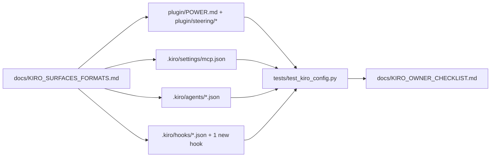

# Design Document: kiro-surfaces

## Overview

This feature turns the Kiro-facing configuration of Ghost in the Macro (`.kiro/hooks/`, `.kiro/agents/`, `.kiro/settings/`, `plugin/`) from "written, never checked" into "written against the documented Kiro format and checked by tests." It changes no engine code, no report schema, no demo output. It produces five artifacts:

- `docs/KIRO_SURFACES_FORMATS.md` — the documented format of each surface, with source URLs, written before any configuration file changes.
- Configuration edits: `plugin/POWER.md`, `plugin/steering/*`, `.kiro/settings/mcp.json`, rewritten `.kiro/agents/*.json`, one new hook file (or a documented "not supported" note).
- `tests/test_kiro_config.py` — written first, observed failing, then made to pass.
- `docs/KIRO_OWNER_CHECKLIST.md` — a table the Owner fills in; no row is pre-filled.
- Usage-log entries, one per task.

The research step (reading `https://kiro.dev/docs/hooks/`, `https://kiro.dev/docs/custom-agents/configuration-reference/`, `https://kiro.dev/docs/powers/create/`, `https://kiro.dev/docs/mcp/configuration/`) already happened during design and is summarised below; task 2 repeats and records it as the Surfaces_Doc, per the ground rule that the document must exist before configuration changes.

## Research summary (sources read 2026-11-25)

- **Hooks** (`https://kiro.dev/docs/hooks/`, IDE 1.0 / CLI V3 schema): a hook file is `{"version": "v1", "hooks": [...]}`. Each hook has `name`, optional `description`, `trigger` (PascalCase, e.g. `PostFileSave`, `PostFileCreate`, `PreToolUse`, `PostToolUse`, `SessionStart`, `Stop`), optional `matcher` (regex against the file path for file-event triggers, or a tool selector for tool-use triggers), `action` (`{"type": "command", "command": ...}` or `{"type": "agent", "prompt": ...}`), optional `timeout` (seconds, command actions only, default 60), optional `enabled`, optional `confirm` (Stop trigger only). **There is no manual trigger in v1.** The four existing files already match this shape exactly.
- **Custom agents** (`https://kiro.dev/docs/custom-agents/configuration-reference/`, IDE 1.0 / CLI V3): a JSON or Markdown+frontmatter file with fields `name`, `description`, `prompt`, `mcpServers`, `tools` (selectors: built-in names `read`/`write`/`shell`/`web`, category tags, `@server`, `@server/tool_name`, `@builtin`, `*`), `resources` (`file://`, `skill://`, or a `knowledgeBase` object), `permissions.rules` (capability-based allow/ask/deny, matched by glob), `includeMcpJson`, `model`, `welcomeMessage`. The four existing agent files use the superseded `tools: ["read", "write", "shell"]` shape, which grants blanket filesystem and shell access and references no MCP tool or resource — this does not match Requirement 5's per-tool limits.
- **Workspace MCP** (`https://kiro.dev/docs/mcp/configuration/`): `.kiro/settings/mcp.json` has one `mcpServers` object; each entry has `command`, `args`, `env` (supports `${VAR}` expansion), `disabled`, `autoApprove`, `disabledTools`. No file currently exists at this path in the repository.
- **Powers** (`https://kiro.dev/docs/powers/create/`, `https://kiro.dev/docs/powers/installation`): a Power needs `plugin.json` (the Agent Plugins 1.0.0 schema — `$schema`, `name`, `version`, `description`, `author`, `keywords`, plus optional `homepage`, `repository`, `license`; `additionalProperties: false`). `skills/` and `mcp.json` are optional. **`POWER.md` is not part of the Agent Plugins format Kiro documents for *creating* a power** — the installation page calls it "the legacy format," supported for *installing* older powers, alongside `plugin.json`. The create-powers page's examples and complete-layout diagrams never include a `POWER.md`. This is the one documented difference the Surfaces_Doc must flag: Requirement 3.2's "where the Surfaces_Doc records that a POWER.md is required or supported" is true only in the weaker sense of "supported for installation of legacy powers," not as a field the create/plugin.json schema defines.

## Architecture

No new runtime component. This is configuration plus one test module plus four documentation files. The only "code" artifacts are:
- `tests/test_kiro_config.py` (pure, filesystem- and JSON-based, no LibreOffice, no network).
- A small helper inside the test module (or a `tests/_kiro_config_helpers.py` if the logic grows) that extracts tool-name tokens from Markdown/JSON and that classifies a candidate path against a hook's matcher regex.



## Components and Interfaces

### `docs/KIRO_SURFACES_FORMATS.md`
Plain Markdown. One section per surface (Powers, Hooks, Custom agents, Workspace MCP), each with: required layout, field table, source URL(s), and a "differs from repository" note where applicable (the `POWER.md` note above; the agent `tools` shape note above).

### `plugin/POWER.md`
Markdown. Contains `name`, `description`, `keywords` matching `plugin.json`, and onboarding steps (uv, LibreOffice, the MCP tools, skill order). Documented as "legacy/installation-only" field in the Surfaces_Doc; included because Requirement 3.2/3.3 ask for it and the install page supports it, but the Surfaces_Doc records that the create/plugin.json schema does not require it.

### `plugin/steering/ghost-guardrails.md`, `plugin/steering/excel-semantics.md`
Byte-identical copies of `.kiro/steering/ghost-guardrails.md` and `.kiro/steering/excel-semantics.md`. `plugin/skills/guardrails/SKILL.md` is edited to point at these copies instead of repeating the text.

### `.kiro/settings/mcp.json`
```json
{
  "mcpServers": {
    "ghost": {
      "command": "<python interpreter>",
      "args": ["-m", "mcp_server.server"],
      "disabled": false
    }
  }
}
```
No GitHub URL, no secrets, no absolute path outside the workspace. Exact `command`/`args` are chosen so `python -m mcp_server.server` (or equivalent entry point already exposed by the package) starts the same `TOOLS` dict the tests import directly.

### `.kiro/agents/{coroner,skeptic,clerk,medium}.json`
Rewritten using the documented fields: `name`, `description`, `prompt` (naming MCP tools, never the CLI), `tools` using `@ghost/<tool_name>` selectors scoped to exactly the tool lists in Requirement 5, `resources` listing the two steering files as `file://.kiro/steering/...`, and `includeMcpJson: true` so the agent picks up the `ghost` server from the Workspace_MCP_Config rather than redeclaring it.

If the documented format cannot express a required *per-call* limit (for example, restricting Clerk's `record_decision` to decisions "a human dictated" — a semantic constraint `tools` selectors cannot encode), the Surfaces_Doc records the gap and the agent's `prompt` carries that instruction instead, per Requirement 5.10.

### `.kiro/hooks/*.json` plus one additional hook
The four existing files are left unchanged (they already match the documented v1 schema — Requirement 6.3). One new hook file is added using the `agent` action type (the documented, currently-unused action type), on a trigger/matcher pair distinct from the four existing ones — for example a `SessionStart` hook with an `agent` action that reminds the agent of the guardrails steering file at session start. If research during task 2 finds the `agent` action type unusable for a safe, in-scope purpose, the Surfaces_Doc records "not supported for this repository's purposes" with the source URL and no extra hook is added (Requirement 6.5).

### `tests/test_kiro_config.py`
Pure pytest module, grouped by requirement:
- tool-name coverage (7.2),
- hook JSON parses + matcher accept/reject (7.3, 7.4, plus the properties below),
- steering byte-identity (7.5),
- Power_Manifest vs Plugin_Manifest equality, skipped silently if no `POWER.md` (7.6),
- agent tool-limit assertions (7.7),
- workspace MCP JSON parse + no GitHub URL (7.8).

## Data Models

No persistent data models. The test module works directly on the JSON/Markdown files in the repository; fixtures are built inline (reading the real files, or constructing small temporary strings for the property tests) rather than loaded from `tests/fixtures/` except for the existing `tests/fixtures/agent-plugins-plugin.schema.json` reused for schema validation (Requirement 3.7).

## Correctness Properties

*A property is a characteristic or behavior that should hold true across all valid executions of a system — essentially, a formal statement about what the system should do. Properties serve as the bridge between human-readable specifications and machine-verifiable correctness guarantees.*

Most of this feature's acceptance criteria are structural checks on a small, fixed set of files (does `POWER.md` exist, do its `name`/`keywords` equal `plugin.json`'s, is each steering copy byte-identical) or process rules for the Build_Agent. Those are written as **example tests**, not property tests, because the input is not generated and varying it would not add coverage (see prework analysis). Two checks genuinely vary with generated input and are written as Hypothesis property tests.

### Property 1: Hook matcher accepts every path matching its intended shape

*For any* hook file among the five hooks (four existing plus the new one) and *for any* path string generated to match that hook's documented intended shape (e.g., for the autopsy hook, `graveyard/<segment>.xlsx` or `graveyard/<segment>.xlsm` with `<segment>` any non-empty string containing no `/`), the hook's `matcher` regex SHALL match that path.

**Validates: Requirements 6.1, 6.3, 7.3**

### Property 2: Hook matcher rejects every generated near-miss path

*For any* hook file among the five hooks and *for any* path string generated to violate exactly one structural condition of that hook's intended shape (wrong extension, wrong directory depth, wrong directory name, or missing/extra path segment), the hook's `matcher` regex SHALL NOT match that path.

**Validates: Requirements 6.1, 6.7, 7.4**

### Property 3: Every mentioned tool name is a declared MCP tool

*For any* tool-name token extracted from `plugin/skills/*/SKILL.md` or `.kiro/agents/*.json`, that token SHALL be a key of `mcp_server.server.TOOLS`.

**Validates: Requirements 5.1, 7.2**

This third property iterates (via `st.sampled_from`) over the token set extracted from the repository's current files rather than over a synthetically generated string space; the token set is fixed and small, but the assertion is still a genuine "for all x in S" statement, run through Hypothesis at the user's request. The first two properties use real generators (`st.text`, `st.sampled_from` over segment alphabets) and are the feature's only properties where 100 iterations can find more than a 2–3 example test would.

## Error Handling

- A format the Surfaces_Doc cannot confirm from a documentation source is marked "not confirmed"; the Build_Agent blocks edits only to the configuration file matching that format and proceeds with the rest (Requirement 2.7/2.9 wording in requirements.md).
- If the Plugin_Manifest schema (`additionalProperties: false`) would reject a field the documented Power format otherwise supports, the conflict is recorded in the Surfaces_Doc and the Owner is asked before `plugin.json` changes (Requirement 3.8).
- If no `POWER.md` exists at test time, the Power_Manifest-vs-Plugin_Manifest test is skipped (`pytest.skip`), not failed and not silently omitted from the report — it shows as "skipped" in the suite count, consistent with the owner's "skip silently" meaning "no failure, no warning text," while still being visible as a skip in `pytest -q` output.
- A baseline test failure halts the whole feature (Requirement 1.3); this is enforced by the Build_Agent's process, not by code.

## Testing Strategy

**Unit/example tests** (`tests/test_kiro_config.py`):
- Each existing hook file parses as JSON and its matcher matches at least one intended path and rejects the three specific near-miss paths named in Requirement 7.4.
- Each `plugin/steering/*.md` is byte-identical to its `.kiro/steering/*.md` original.
- `plugin/POWER.md` name and keywords equal `plugin.json`'s, skipped if `POWER.md` does not exist.
- Each agent's `tools` selectors resolve to exactly the tool list in Requirement 5 for that agent.
- `.kiro/settings/mcp.json` parses as JSON and contains no GitHub URL substring.
- `plugin.json` still validates against `tests/fixtures/agent-plugins-plugin.schema.json`.

**Property tests** (Hypothesis, explicit seed, no LibreOffice, minimum 100 iterations each):
- Property 1 and Property 2, parameterised over the five hook files.
- Property 3, iterating over the extracted token set.

Each property test is tagged `# Feature: kiro-surfaces, Property N: <title>` per repository convention, cites the Hypothesis strategy used, and the requirement(s) it validates.

Per Requirement 7.9, `tests/test_kiro_config.py` is written and run (observed failing against the current `.kiro/agents/*.json`, the absent `.kiro/settings/mcp.json`, and the absent `plugin/POWER.md`/`plugin/steering/`) before the corresponding configuration files are changed.
