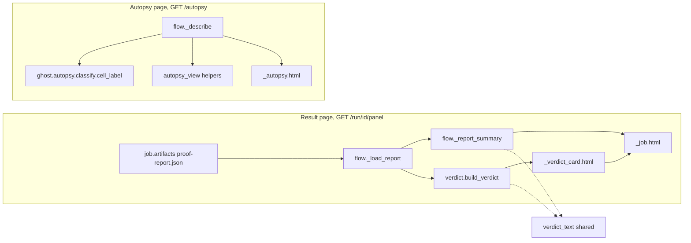

# Design Document: readable-proof

## Overview

This feature makes the result and the autopsy readable. Part A adds a Verdict_Card built by a new pure module, `web/verdict.py`, from the parsed Proof_Report and nothing else. Part B changes the autopsy templates so that input and output choices carry a label, a value or a formula, the Finding shows each conflicting location, Decisions are radio cards, and cells that were not converted get a panel of their own.

No business logic moves into the templates. Every sentence on the card comes from a field of the Proof_Report, and every number the card prints is an entry of the `numbers` mapping that `build_verdict` returns, so a test can check the dict instead of scraping text (Requirement 1.7, 12.5). The engine changes in exactly one place: a public label function in `ghost/autopsy/classify.py` (Requirement 8.5). The Proof_Report schema, `ghost/report/` and the report HTML the engine writes are not touched.

Design decisions the Owner made in review (recorded in `requirements.md`) that shape this design:

- The Headline claims agreement only for `passed` true with no mismatches, and `claims_agreement` carries that claim as a flag (Requirement 2).
- The old verdict paragraph and the mutation line stay, unchanged, below the card as small secondary text. They are not hidden from assistive technology (Requirement 7.2).
- Work is ordered Part A, then Requirements 8 and 9, then 10 and 11, so the later steps can be cut.

## Architecture



The Verdict_Module and the autopsy helpers are pure. `web/flow.py` stays the only place that touches the session, the engine and the job runner.

### Files

| File | Change |
|---|---|
| `web/verdict.py` | New. `build_verdict`, `verdict_text` (moved from `web/flow.py`), small formatting helpers. Standard library only. |
| `web/autopsy_view.py` | New, pure. Finding title, consequence sentence, formula segments with the conflicting operator marked, checkbox label text. Standard library only. |
| `ghost/autopsy/classify.py` | One public function `cell_label` with the exact body of `_left_label`; `_left_label` delegates to it. `__all__` gains the name. |
| `web/flow.py` | Imports `verdict_text` and `build_verdict`; new `_load_report`; `_job_ctx` adds `verdict`; `_describe` adds labels, values, formulas and finding details. |
| `web/templates/_verdict_card.html` | New partial. |
| `web/templates/_job.html` | Includes the card above the iframe; moves the Detail_Paragraph and the mutation line below the card. |
| `web/templates/_autopsy.html` | Labelled checkboxes, Finding_Card, Decision_Cards, Not_Converted_Panel. |
| `web/templates/index.html` | One more `<script defer>` for the author name. |
| `web/static/author-name.js` | New. Remembers the author name in `localStorage`. |
| `web/static/style.css` | Card, tiles, strip, finding and decision cards, panel. The old `.verdict` rules become the small detail style. |

## Components and interfaces

### `web/verdict.py`

```python
def verdict_text(d: dict) -> str: ...
def build_verdict(report: dict) -> dict: ...
```

No import of `ghost`, `fastapi`, `jinja2`, `os`, `time`, `random`, `pathlib` or `subprocess` (Requirement 1.2). A test reads the module source and checks the import list. `build_verdict` reads its argument and never assigns into it (Requirement 1.3); it works on local copies.

#### `verdict_text`

Moved from `web/flow.py` (Requirement 2.1); `web/flow.py` imports it, so `from web.flow import verdict_text` keeps working. Its outputs are unchanged except for one rule (Requirement 2.4): the "no unexplained difference" state needs the mode to be exactly `intended`. Any other mode with mismatches now returns the bare "Passed". The existing tests build their reports with mode `intended` for that state, so none changes.

States, in the order the function tests them:

| Condition | Text | `claims_agreement` |
|---|---|---|
| `passed` is not a boolean | `Verdict not available` | false |
| `mismatches` is not a list of objects (and not empty or absent) | bare `Passed` or `Not passed` | false |
| `passed` true, no mismatches | `Passed: no difference found on N cases` | **true** |
| `passed` true, mode `intended`, every mismatch `expected by decision` | `Passed: no unexplained difference found on N cases; K expected by decision <ids>` | false |
| `passed` true, any other mismatch situation | `Passed` | false |
| `passed` false | `Not passed: K difference(s) found`, or `Not passed` when K is 0 | false |

N is `cases_tested` when it is a positive integer that is not a boolean; otherwise the sentence reads `number of cases: not checked` in its place (Requirement 2.8). K is the number of mismatches whose class is not `expected by decision`. The ids are the sorted distinct `decision_id` values of the explained mismatches.

#### `build_verdict` result

```python
{
  "headline": str,                  # verdict_text(report)
  "claims_agreement": bool,         # true iff passed is True and mismatches == []
  "state": "agreement" | "explained" | "not_passed" | "unavailable" | "unsupported",
  "tiles": {
    "inputs":        {"generated": Item, "targeted": Item, "distinct": Item},
    "disagreements": {"total": Item, "by_class": [ {"class": str, "count": Item} ]},
    "planted_bugs":  {"text": str, "bar": {"killed": int, "total": int} | None,
                      "survivors": [ {"mutant_id": str, "reason": str} ],
                      "explanation": str | None},
  },
  "counterexample": None | {...},
  "not_proven": {...},
  "reproduce": {"command": str, "caption": str},
  "glossary": [ {"term": str, "text": str} ],
  "numbers": { str: int },
}
```

`Item` is `{"label": str, "value": int | None, "text": str}`: `text` is the number as a string, or `not checked` when the field is missing or has the wrong type (Requirement 1.5, 3.1). A tile item that has a value also has a `numbers` entry with the same value.

`state` drives the card's icon and edge (Requirement 4.6, 3.10): `agreement` when `claims_agreement` is true; `explained` for the intended state; `not_passed` for `passed` false; `unavailable` when `passed` is missing; `unsupported` for the bare "Passed" of a self-contradicting report.

#### Tiles (Requirement 3)

- **Inputs:** `cases_generated`, `cases_targeted`, `distinct_cases`, each from the report or `not checked`.
- **Disagreements:** the number of mismatches and, for each class that occurs, the number sharing that class value. Classes are listed in the schema order (`translation bug`, `original workbook inconsistency`, `expected by decision`); a class with 0 entries is listed with 0.
- **Planted bugs:** if `mutation` has an integer `total` and an integer `killed`, the text is `K of T` with the recorded values and, when `total` is greater than 0, `bar = {killed, total}`; `total` 0 reads `0 of 0` with no bar (Requirement 3.4). If `mutation` has no `total`, the text is exactly `not checked` and `bar` is `None` (Requirement 3.5). The recorded numbers are never corrected when they disagree with the `mutants` list (Requirement 3.6). Survivors are every record of `mutants` whose `killed` is not `True`, in list order, each with `mutant_id` and its `survivor_reason` or `no reason recorded` (Requirement 3.7, 3.8); `explanation` is `survivor_explanation` when present. The survivor test is `is not True` rather than `is False` so that a record without a flag is listed, never silently counted as killed.

#### Counterexample (Requirement 4)

Chosen by: the first mismatch with `minimal` true, else the first mismatch. Result:

```python
{"inputs": [ {"name": str, "value": str} ],
 "output": str,                       # `output`, else `cell`, else "not checked"
 "workbook_says": [ {"key": str | None, "value": str} ],
 "new_code_says": [ {"key": str | None, "value": str} ],
 "class": str, "plain": str, "decision_id": str | None, "finding_id": str | None,
 "cases": int | None}
```

When `output` is a key of both `expected` and `actual`, each side has one entry, `expected[output]` and `actual[output]`, with `key` `None`. Otherwise both sides list every key whose recorded values differ, each with its key (Requirement 4.3). Values are copied as recorded: strings as they are, numbers with Python's `str` (so `6.0` stays `6.0`, and `"0"` stays `0`), anything else as compact JSON. The plain words are a fixed table (Requirement 4.4):

| Class string | Plain words |
|---|---|
| `translation bug` | the new code differs from the workbook, and no Finding or Decision accounts for it |
| `original workbook inconsistency` | the new code differs from the workbook where the workbook's own formulas disagree (Finding F-001), with the parenthesis left out when there is no `finding_id` |
| `expected by decision` | expected by decision (shown once, with the Decision id and the Finding id) |
| any other string | the class string as recorded, with no plain words |

The `cases` field is set only when the mismatch has an integer greater than 1 (optional, Requirement 4.5). A `numbers` entry `counterexample_cases` is added only then.

#### Not proven (Requirement 5)

```python
{"boundary_notes": [str], "domains_not_tested": [str],
 "rules_not_seen": [ {"rule_id": str, "condition_id": str, "side": str} ],
 "excel": str, "not_converted": [ {"cell": str, "reason": str} ],
 "empty": {"boundary_notes": str, ...}}      # optional wording, Requirement 5.6
```

`boundary_notes` are copied verbatim. `domains_not_tested` lists the `input` of each `tested_domains` row whose `not_tested` is true. `rules_not_seen` names the rule, the condition and the side (`true`, `false` or `true and false`) that was never seen. `excel` is the sentence of Requirement 5.5: `Not cross-checked against Excel.` when `sanity.status` is `not cross-checked against Excel`; `Excel cross-check: matched.` or `Excel cross-check: differences.` for those statuses; `Excel cross-check: not checked.` when `sanity` has no status. `not_converted` copies each entry's `cell` and `reason`, with `no reason recorded` for an entry that has none. The strip is always rendered, with the same container and heading level as a tile (Requirement 5.1).

`numbers` gets `boundary_notes`, `domains_not_tested` and `not_converted`, the lengths or counts of those lists. No count is printed for `rules_not_seen`, because "seen_true or seen_false is false" is a union and not a count of one shared value.

#### Reproduce line and glossary (Requirement 6)

`command` is `python -m ghost.cli verify <migration-dir> --mode <mode> --seed <seed>`, with the literal placeholder kept, `mode` and `seed` from the report, and `not checked` for either one that is missing or has the wrong type. There is no `--cases`. `caption` is the fixed string `Run from the migration folder; add --mutation-cases to repeat the planted-bug check.` The glossary is four fixed sentences (Referee, mutant, Faithful, Intended) that describe what each term does and make no claim about correctness.

#### `numbers`

Every number the card prints has an entry. The Headline's N and K are in it (`cases_tested`, `expected_by_decision`, `differences`), as are the tile values, `killed`, `total` and `survivors`. An entry exists only when its value is a real integer (not a boolean, not negative). The template never computes a number: tiles print the `text` of an `Item`, which the builder makes from the same value as its `numbers` entry, and the Headline and the cases line read `numbers`.

### `web/autopsy_view.py`

```python
def finding_title(kind: str) -> str                      # "operator_conflict" -> "Operator conflict"
def short_ref(ref: str, same_sheet_as: str) -> str       # "Calculator!B7" -> "B7" on the same sheet
def consequence(constant: str, locations: list[dict]) -> str
def formula_segments(formula: str, op: str, constant: str) -> list[tuple[str, bool]]
def checkbox_text(cell, label, value=None, formula=None) -> str
```

- `consequence` builds `at exactly 50, B7 uses >= and B9 uses >` from the Finding's own fields. With three or more locations the parts are joined with commas and a final `and`. A macro location is named `module:line`. It contains no outcome (Requirement 9.3, 9.4).
- `formula_segments` splits a formula into `(text, is_operator)` pieces so that the template can wrap the conflicting operator in `<mark class="op">` and escape every piece. It scans comparison tokens left to right (`<>`, `<=`, `>=`, `=`, `<`, `>`) and marks the first token equal to `op` that sits next to the constant, else the first token equal to `op`, else none. The haunted `B7` compares with `E2`, not with a literal 50, so the fallback applies there.
- `checkbox_text` is `label (address)` or the address alone, then `, value in the workbook: V` for an input with a stored value, or `, formula: F` for an output (Requirement 8.1 to 8.4).

### `ghost/autopsy/classify.py`

```python
def cell_label(wb: Workbook, ref: CellRef) -> str | None:
    """Text of the immediately left-adjacent constant text cell, if any."""
    ...  # the exact body of the old _left_label

def _left_label(wb, ref):
    return cell_label(wb, ref)
```

`__all__` gains `"cell_label"`. `ghost/converter/mapping._label` and the rules namer are not touched (Requirement 8.5). A test asserts that `cell_label`, `_left_label` and `mapping._label` agree for every cell of the three sample workbooks, as a guard for the equivalence this design relies on.

### `web/flow.py`

- `_load_report(job) -> dict | None` parses `proof-report.json` once; `_report_summary` and the card use it. A missing or unparseable file gives `None`, and then no card is rendered (Requirement 7.5).
- `_job_ctx` adds `"verdict": build_verdict(report)` when the job is terminal and a report exists.
- `_describe` adds, for each input, `label` (from `cell_label`) and `value` (the cell's stored constant as loaded, or `None`), and for each output `label` and `formula`. For each Finding it adds `title`, `kind`, per-location `formula` or `module` and `line`, `segments`, and `consequence`. The default selection is unchanged.

### Templates

`_verdict_card.html` takes `v` (the dict above) and `job_id`.

```html
<section class="verdict-card" data-state="{{ v.state }}" aria-labelledby="vc-h-{{ job_id }}">
  <h3 id="vc-h-{{ job_id }}" class="vc-headline">{{ v.headline }}</h3>
  <!-- counterexample, three tiles, not-proven strip, reproduce line, glossary -->
</section>
```

The headline is the large line of the card (Owner design note 1). The card has no `role="status"`: the Detail_Paragraph keeps its `role="status"`, so a screen reader announces the result once. Below the card, `_job.html` renders the Detail_Paragraph unchanged (`<p class="verdict pass|fail|unavailable" role="status">` with its text) and the `mutation-summary` line. They are styled as small secondary text and are not `aria-hidden`.

The state is shown by an icon and text as well as colour: a filled check seal for `agreement`, a hollow check for `explained`, a "not equal" ring and a heavy left edge for `not_passed`, a dashed question mark for `unavailable`, a dashed exclamation mark for `unsupported`. The planted-bugs bar is a `<progress>` with a text label, and survivors are listed as text. Animations, if any, sit inside `prefers-reduced-motion: no-preference`; the card is fully visible without them.

`_autopsy.html`:

- Checkbox `<input>` elements keep the attribute set and order `type`, `name`, `value`, `checked`; only the text after them changes, and every piece is auto-escaped by Jinja (Requirement 8.6, 8.8).
- The Finding heading keeps the id and the cell and constant: `F-001: Operator conflict on Calculator!B2 against 50`. Each location is a list item: cell locations show the formula in `<code>` with the conflicting operator in `<mark class="op">` and the words `uses >=` beside it as the non-colour cue; macro locations show `module, line N` and no formula. The consequence sentence follows.
- Decision options are `label.decision-card` elements around the same radio inputs. The author field gets `autocomplete="name"` and a `data-remember="author"` hook. The reason input has no `value` attribute.
- The Not_Converted_Panel is a `<section class="panel not-converted" aria-labelledby=...>` with its own `<h3>`; each entry shows the cell and the reason (or `no reason recorded`), and each not-verifiable entry shows cell, kind and detail. It is not rendered when both lists are empty.

### `web/static/author-name.js`

Reads and writes `localStorage["ghost-author"]` only. On `DOMContentLoaded` and after each `htmx:afterSwap`, it fills any `input[name=author]` that is empty and saves the value on `input`. It never touches the reason field and sends nothing anywhere itself (Requirement 10.2, 10.3). Storage errors are caught and ignored.

## Data models

No new persistent data. `build_verdict` reads the Proof_Report fields listed in `requirements.md` (Introduction) and returns plain dicts, lists, strings, integers and booleans. Nothing is added to the report, and nothing is written to disk.

## Correctness properties

Property tests use Hypothesis with seed 20261204 over a generator of schema-valid reports (every draw is validated against `ghost/report/schema/proof-report-1.json` with `jsonschema` in a separate test), and they check the dict that `build_verdict` returns. Each file carries `# Feature: readable-proof, Property N: <title>`.

### Property 1: The Headline claims agreement only for a passed report with no mismatches
For any report, `claims_agreement` is true only if `passed is True` and `mismatches == []`. Conversely, a report with `passed` true and an empty `mismatches` list has `claims_agreement` true.
**Validates: Requirements 2.2, 2.3, 13.2**

### Property 2: Every number is traceable
For any report, every value in `numbers` is a numeric value of the report (`cases_tested`, `cases_generated`, `cases_targeted`, `distinct_cases`, `mutation.killed`, `mutation.total`, a mismatch's `cases`, a domain's `distinct_values`), or the length of one of its arrays, or the number of entries of one array that share, or do not share, a recorded field value (the second form covers K and the survivor count; see the amendment in Requirement 12.5). The reference set is computed in the test from the report itself, independently of `build_verdict`; 0 is always allowed as a count of no entries. Ids, cell addresses and the seed are not numbers for this property.
**Validates: Requirements 1.7, 12.5, 13.3**

### Property 3: A mutation block that was not run reads "not checked"
For any report whose `mutation` is `{"status": "not checked"}`, the planted-bugs text is exactly `not checked` and the bar is `None`.
**Validates: Requirements 3.5, 13.4**

### Property 4: No surviving mutant is hidden
For any report with a mutation block, the survivors listed are exactly the records of `mutants` whose `killed` is not true, in order, one entry each.
**Validates: Requirements 3.7, 13.5**

### Property 5: "Excel" never appears in a sentence that claims agreement unless the cross-check matched
For any report with `claims_agreement` true, the Headline contains the word "Excel" only if `sanity.status` is `matched`.
**Validates: Requirements 5.7, 13.6**

### Property 6 (optional): Determinism and no mutation
For any report, two calls return equal results and the argument is equal to a deep copy taken before the first call.
**Validates: Requirements 1.3, 1.4, 13.7**

## Error handling

- A report field that is missing or has the wrong type gives `not checked` for that item and never an exception (Requirement 1.5). A test feeds `{}`, a report with every field set to `None`, and a report with wrong types, and asserts that `build_verdict` returns a dict with `headline` `Verdict not available`.
- A missing or unparseable `proof-report.json` gives no card and the existing text (Requirement 7.5).
- A cell with no label shows its address; an input with no stored value omits the value (Requirement 8.3, 8.4). A label or value that contains markup is escaped, never inserted raw (Requirement 8.8).
- `POST /decision` with an empty reason still returns 422; the template adds no default for it (Requirement 10.3, 10.4).

## Testing strategy

Test first, one file per concern, all new files; no existing test is edited.

| File | What it covers |
|---|---|
| `tests/test_verdict.py` | Unit tests for `verdict_text` states, `build_verdict` headline, tiles, counterexample (including the `output` fallback and the haunted Intended values), not-proven strip, reproduce line and caption, glossary, purity (import list), robustness on empty and mistyped reports, banned words. |
| `tests/test_property_verdict.py` | Properties 1 to 6 over generated reports; a test that every generated report is schema-valid. |
| `tests/test_web_verdict_card.py` | Renders `_job.html` and `_verdict_card.html`: a failing report shows the failure style and the Counterexample; the haunted Intended card shows quantity 50, workbook says 6.0, new code says 0, D-001 and F-001; `0 of 0` has no bar; the Detail_Paragraph and the mutation line are still present below the card with their classes and are not `aria-hidden`; no card without a report. |
| `tests/test_autopsy_view.py` | Pure helpers: consequence sentence, formula segments, checkbox text, finding title. |
| `tests/test_cell_label.py` | `cell_label` equals `_left_label` and `mapping._label` for every cell of the three samples. |
| `tests/test_web_autopsy_readable.py` | Labelled checkboxes on the bundled samples, with the default selection unchanged and the markup still matching `tests/test_web_samples.py`'s pattern; `<script>` in a label is escaped; the haunted autopsy shows each location of F-001 with its formula and the consequence sentence; Decision_Cards keep the radio attributes; the reason has no value; `POST /decision` with an empty reason returns 422; the Not_Converted_Panel appears only when there are entries. |

Existing tests that pin the markup (`tests/test_web_samples.py`, `tests/test_web_flow.py`, `tests/test_web_verdict_text.py`, `tests/test_web_progress_rail.py`) stay unchanged and must pass. The demo invariants are checked at the final checkpoint with `scripts/demo.sh` and the full suite.

## Build order

1. **Part A** (Requirements 1 to 7, Properties 1 to 5 and their examples): `verdict_text` move, `build_verdict`, card template, wiring, style. Optional items last: the `cases` line (4.5), the "none" wording (5.6) and Property 6.
2. **Requirements 8 and 9:** `cell_label`, labelled checkboxes, Finding_Card.
3. **Requirements 10 and 11:** Decision_Cards with the remembered author name, then the Not_Converted_Panel.

If time runs short the cut order is: the optional items, then Requirements 10 and 11.

## Risks and notes

- The Headline and the Detail_Paragraph share an opening sentence by design (one function). They differ in size and position only.
- Moving `verdict_text` changes its behaviour in one case (a non-`intended` mode with mismatches). Reports the engine writes cannot reach it, because Faithful mode passes only with no mismatches.
- Labels come only from the cell directly to the left, so most cells of the scenarios table show the address alone (a known limit in `requirements.md`).
- The operator highlight is a presentation aid on the formula text. It does not claim to locate the exact comparison the engine used, and the words "uses >=" beside it carry the information without it.
