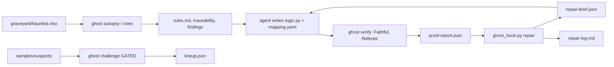

# Design Document: trial-by-workbook

## Overview

The workbook, recalculated by LibreOffice, referees a rewrite. Part A names that act (`ghost challenge`) and shows it on a line-up of suspects. Part B closes the loop for an agent: a failed round produces a small brief, the agent repairs against the brief, and a script keeps an honest log. Everything outside the one engine addition (`ghost/challenge.py`, gated on the Owner's approval) is a script, a sample, a skill or a spec folder; nothing changes the verifier, the report schema or the generated code.

## Components

### Suspects (`samples/suspects/<workbook>/`)

Each folder has a pinned `mapping.yaml` (inputs by name with cell, type and minimum; one output) and Candidate modules, each a pure `compute(inputs) -> dict` using only the standard library (`decimal`). Every header says how the file was written and what it plants; no header claims AI authorship (no prompt is committed beside the suspects). The haunted set: `honest.py` (keeps both quirks: discount at `>=`, free delivery at `>`), `tidied.py` (a plausible "fix" that makes both comparisons `>=`), `float_rounding.py` (binary floats and Python `round()`), `dropped_branch.py` (no free-delivery branch). The discount set: `honest.py`, `gt_slip.py`, `float_rounding.py`, `dropped_branch.py`. Labels in the headers are written after the measurement of `samples/suspects/MEASURED.md`, not before.

### The measurement and the line-up

Until `ghost challenge` exists, `scripts/lineup.py` measures each Suspect by building a temporary migration folder (workbook path, mapping, the Candidate as `logic.py`) and running the existing `python -m ghost.cli verify <dir> --mode faithful --seed 20261204` as a subprocess, reading the resulting `proof-report.json`. It writes `samples/suspects/<workbook>/lineup.json`. It never writes into a migration's `reports/` folder. When `ghost challenge` is approved and built, the script calls it instead; its output format is the verdict of Requirement 1.

### `ghost/challenge.py` (gated)

`run_challenge(workbook, code, mapping=None, seed=DEFAULT_SEED) -> ChallengeResult`: refuse generated code; build a temporary migration folder; run the existing verification in Faithful mode; read the report; assemble the verdict (counts, seed, LibreOffice version, and either the no-difference line or one counterexample with its rule id and EARS text from the temporary folder's `rules.md`); decide "shrunk" (the failure came from the generated search: `cases_generated > 0`) or "targeted boundary case, not shrunk" (`cases_generated == 0`). `ghost/cli.py` gets one `challenge` subparser that prints it and returns 0, 1 or 2.

### `scripts/repair_brief.py`

`build_brief(migration_dir) -> dict` and a command-line entry. It reads `proof-report.json`, `rules.md`, `source.yaml` and the workbook (for the source formula), picks the minimal failing mismatch, and writes `repair-brief.json` with sorted keys and no absolute path (the workbook is referred to by cell, never by path). `{"status": "passed"}` when the report passed.

### `scripts/ghost_hook.py`

A `repair` kind: `repair <migration-dir>` runs after the verify kind (the `verify` branch calls it), does nothing when `logic.py` is missing or Ghost-generated, and otherwise (1) writes the brief, (2) appends one block to `repair-log.md`: round number (the count of existing blocks + 1), time (ISO, local), seed, cases (generated, targeted, distinct), pass or fail, the counterexample or "none", the planted label when `GHOST_PLANTED` is set, and "not converged" after five consecutive failed rounds. The log is written only here.

### The agent migration

`graveyard/haunted.xlsx` is generated by `samples/make_haunted.py` and committed through a `.gitignore` exception. `ghost rules graveyard/haunted.xlsx --migration .kiro/specs/haunted-delivery-migration` writes the spec. A fresh agent session (no earlier context) is given `agent-prompt.md` (committed in the folder), reads only `rules.md`, `traceability.yaml`, `findings.yaml` and the skills, and writes `logic.py` and `mapping.yaml`. Verification runs `ghost verify --mode faithful`, whose hook step writes the log and the brief. The prompt text, its date and the tools the agent had are recorded in the usage log.

## Testing strategy

| File | What it covers |
|---|---|
| `tests/test_repair_brief.py` | Brief for passed and failed reports, the minimal mismatch rule, "not available" fields, no absolute path; Property 3 over generated schema-valid reports (shared generator). |
| `tests/test_repair_hook.py` | The repair step on a temporary migration folder with a hand-written `logic.py` and a stub report: log blocks, round counting, "not converged" after five, the planted label only with the variable, nothing extra for generated code; the existing hook JSON unchanged. |
| `tests/test_suspects.py` | Each Suspect imports, exposes `compute`, has a header and a pinned mapping that matches the workbook; (Referee-backed, skipped without LibreOffice) the measured labels equal the measured results; the honest suspect passes across several seeds (Property 1). |
| `tests/test_challenge.py` (gated) | The command's exit codes, output lines, "shrunk" wording, refusal of generated code, no "correct"; counterexamples reproduce (Property 2). |
| `tests/test_agent_migration.py` | The committed folder is complete, `logic.py` has no generated marker, the log is the script's format, the folder's proof report passes. |
