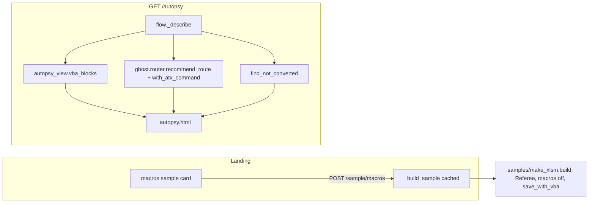

# Design Document: vba-on-screen

## Overview

The autopsy screen gets two new panels, the VBA_Panel and the Route_Panel, and the landing page gets a fourth sample, built from the existing `samples/make_xlsm.py`. No business logic moves into templates: the VBA text comes from `Workbook.vba_modules` (read statically by the engine), the route from `ghost.router.recommend_route`, and the new pure helpers in `web/autopsy_view.py` only cut and describe what the engine returned. The engine is not changed, and no code path in `web/` can run a macro.

## Architecture

### Files

| File | Change |
|---|---|
| `samples/make_xlsm.py` | New `build(path)`: the faithful macro workbook alone, one Referee start, `run_macros=False`. `build_pair` unchanged. |
| `web/app.py` | `SAMPLES["macros"]`, its blurb, a once-per-process build cache with a lock, the macro media type for the download, a 503 path (existing "Referee unavailable" card) when the Referee cannot start. |
| `web/autopsy_view.py` | `vba_blocks(modules)` (line caps and notes) and `route_view(route)`, both pure. |
| `web/flow.py` | `_describe` adds `vba_blocks`, `route`; a small `_route_for(metrics)` with the threshold fallback. |
| `web/templates/_autopsy.html` | VBA_Panel, Route_Panel, `role="alert"` on the VBA read error. |
| `web/static/style.css` | Panels and code blocks. |

## Components

### Macro_Sample build and cache

`build(path)` mirrors `build_pair` for one file: build the base workbook with openpyxl in a temporary folder, start one `RefereeClient(soffice_path, base, run_macros=False, job_dir=tmp)`, open the base and call `save_with_vba(path, {"Module1": FAITHFUL_SOURCE})`. Nothing is run; the VBA text is stored in the document.

The web layer builds this once per process. `_build_sample("macros", dest)` takes a lock, builds into a temporary folder if the process has no bytes yet, keeps the bytes in a module-level dict, and writes them to `dest`. A second request while the first builds waits on the lock, so there is never a second LibreOffice start. A failed build is not cached. Measured: about 2.9 s per file on a Mac (5.8 s for two); the container was not measured. The alternative of building at container start was not used because test and health-check apps would start LibreOffice; the first visitor pays once.

### `vba_blocks(modules)`

Input: a list of `{"name", "source", "line_count"}`. Output: one dict per module `{"name", "line_count", "text", "note"}`. Limits: 400 lines per module and 2000 in all. A cut module has the note `Showing the first N of M lines.`; a module that gets no lines has `Not shown: the display limit of 2000 lines was reached. The module has M lines.` and an empty text; an empty module has the note `The module is empty.` The text is returned raw; the template escapes it.

### Route

`_route_for(metrics)` calls `recommend_route(metrics, thresholds)`. The thresholds come from `load_thresholds()`, which reads `.kiro/steering/routing-thresholds.md`. That file is not in the Docker image (`.dockerignore` excludes `.kiro`), so on `ThresholdError` the code falls back to `DEFAULT_THRESHOLDS`, which equals the file today; a test pins that equality so a change to the file is noticed. `with_atx_command(route)` is called with no workbook, so the command carries `<workbook-directory>` and no path. `route_view` returns `{"route", "reasons", "command"}`.

### Templates

- VBA_Panel: `<section class="panel vba-source" aria-labelledby="vba-h"><h3 id="vba-h">VBA source: read, never run</h3>`, the one-sentence statement (Requirement 2.6), then one `
` per block with `
{{ name }}, {{ line_count }} lines
<pre class="vba-code"><code>{{ text }}</code></pre>` and the note. Autoescape is on; nothing is marked safe.
- Route_Panel: `<section class="panel route" aria-labelledby="route-h">` with the heading "Migration route", the route name, the reasons, the sentence of Requirement 4.4 and, only for an AWS or Split route, `
suggested command, not run:
<code>…</code>`.
- The VBA read error: `<li class="error" role="alert">{{ vba_error }} (VBA: not checked)</li>`.

## Correctness checks

This feature has no Hypothesis properties: its claims are about rendering fixed inputs. The checks are example tests, listed in the Testing section, plus one source-level test that `web/` and `samples/make_xlsm.py` contain no `run_macros=True` or `trust_macros`.

## Error handling

- Referee cannot start while building the Macro_Sample: a 503 with the existing "Referee unavailable" card; other samples are unaffected, and the failed build is not cached.
- VBA unreadable: the existing error line (now with `role="alert"`), no VBA_Panel.
- Router thresholds unreadable: the built-in defaults are used (above).
- An oversized module: shown in part, with the note.

## Testing strategy

| File | What it covers |
|---|---|
| `tests/test_vba_blocks.py` | `vba_blocks` caps and notes; `route_view`; the threshold fallback and the equality of the defaults with the steering file. |
| `tests/test_web_vba_panel.py` | Rendered autopsy from hand-made contexts (heading, closed blocks, escaped `<script>`, caps, no panel without VBA, error with `role="alert"`, every `.error` has `role="alert"`, Route_Panel for the three routes, command label and placeholder, no server path); a real `.xlsm` with a hostile module through `save_with_vba` and the app (skipped without LibreOffice); the Macro_Sample end to end (card, load, autopsy, not-converted cell, route, a real Faithful run with its default cells). |
| `tests/test_no_macro_run.py` | Source-level: no `run_macros=True`, `trust_macros` or equivalent in `web/` and `samples/make_xlsm.py`; the build uses `run_macros=False`. |

## Legacy `.xls` (Requirement 7)

A real conversion is tried with the Referee's LibreOffice (`--convert-to`, macros off) on an `.xls` made from the Macro_Sample's base workbook, and the outcome is reported, built only if clean and short.
